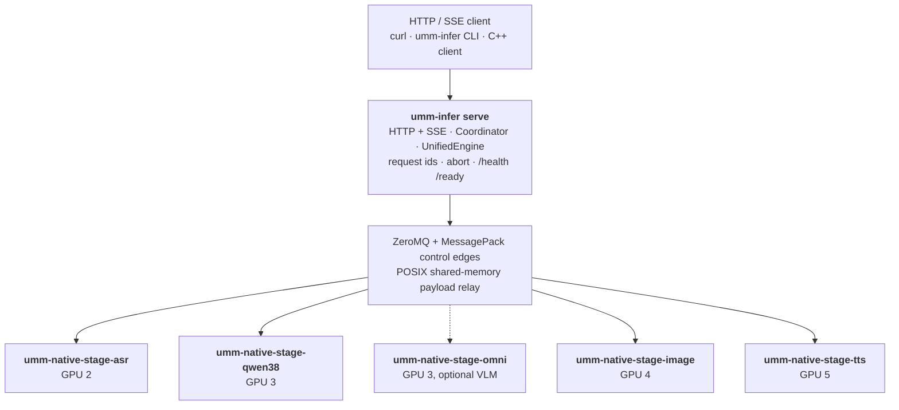

# Architecture

ummInfer is a C++20 inference runtime for unified multimodal models. It has
three parts.

1. `umm-infer` is the control plane. It serves an OpenAI-compatible HTTP and
   SSE surface, keeps request state, and runs the Coordinator.
2. The Coordinator talks to the stages over ZeroMQ with MessagePack control
   frames. Large payloads move through POSIX shared memory.
3. Each stage is one process. A stage loads one model on one GPU and handles
   one request at a time.

No Python, PyTorch, vLLM or SGLang runs on the serving path. `ldd` on a stage
binary lists the CUDA runtime, libzmq, libmsgpackc and system libraries only.

## Request plans

One request runs an ordered plan. The ASR entry is optional. The VLM leg
follows it. The image and TTS legs are optional outputs.

| Path | Stages | Terminal event |
| --- | --- | --- |
| Text chat | VLM | `complete`; Qwen3.8-27B also emits one `vlm_delta` per token |
| Audio to text | ASR, VLM | `asr_final`, VLM deltas, `complete` |
| Image and text to text | VLM | `complete` |
| Text to speech | VLM, TTS | `complete` with one WAV `artifact` |
| Text to image | VLM, image | `complete` with one PNG `artifact` |
| Mixed input and output | ASR, VLM, image and TTS | `complete` with two `artifact`s |

Exactly one VLM stage runs at a time. The service config selects `qwen38`
(default) or `omni`.

## Stage contract

Each stage registers with the `Stage::Config` contract: `recv`, `coordinator`,
`abort`, `announce_ready`. The server queues requests until a stage announces
readiness. `/ready` returns 200 after the entry stage and the VLM stage are
ready. The image and TTS legs never gate `/ready`.

## Endpoints

- `POST /v1/chat/completions` — chat, with optional image, audio, speech and
  image output fields.
- `POST /v1/audio/transcriptions` — ASR.
- `/health`, `/ready` — process and readiness probes.
- `--realtime-port` — WebSocket ASR listener.

The `umm-infer chat`, `transcribe`, `realtime` and `image` subcommands use the
same endpoints. Run `umm-infer serve --help` for the full flag list.
